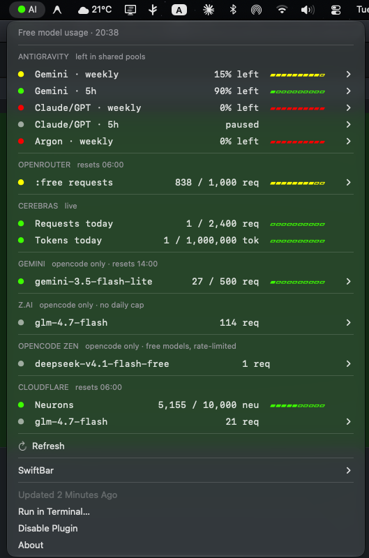

# quota-bar

**See every free AI model quota you have, in one place, right in your Mac menu bar.**

Free tiers are generous when you combine them (OpenRouter, Cerebras, Gemini, Z.ai, Cloudflare Workers AI), but every provider counts differently and hides its limits somewhere else. `llm-usage` pulls them together so you know which model still has room before your coding agent hits a 429.



## Features

- 🟢🟡🔴 One dot in the menu bar for your overall usage; one colored row per model inside
- Live numbers straight from providers that expose them (OpenRouter, Cerebras, Cloudflare)
- Local counts from [opencode](https://opencode.ai) history for providers that don't (Gemini, Z.ai)
- Reset times shown in your own time zone
- Click any provider to open its dashboard
- Same view in the terminal: `llm-usage`
- Single Python file, standard library only, works with the Python that ships with macOS
- Providers without a key are simply hidden

## Supported providers

| Provider | Source | What you see |
|---|---|---|
| OpenRouter | live API | free-model requests used of daily limit, credit spent |
| Cerebras | live rate-limit headers | requests and tokens used today |
| Google Gemini | opencode history | requests per model vs the free-tier daily limit |
| Z.ai | opencode history | requests and tokens per model |
| Cloudflare Workers AI | live GraphQL + opencode history | neurons used of 10,000/day, requests per model |
| Antigravity | `agy-quota` helper in `~/.local/bin` | % left in each model pool and reset time |

## Install

```bash
git clone https://github.com/Appentium/quota-bar ~/quota-bar
mkdir -p ~/.local/bin ~/.swiftbar
ln -s ~/quota-bar/bin/llm-usage ~/.local/bin/llm-usage
ln -s ~/quota-bar/swiftbar/llm-usage.15m.sh ~/.swiftbar/llm-usage.15m.sh
brew install --cask swiftbar
defaults write com.ameba.SwiftBar PluginDirectory -string "$HOME/.swiftbar"
open -a SwiftBar
```

The menu refreshes every 15 minutes. Rename the plugin to `llm-usage.30m.sh` to change that.

## Keys

Add whichever you have to `~/.zshrc`. Each key is only sent to its own provider.

| Variable | Where to get it |
|---|---|
| `OPENROUTER_API_KEY` | openrouter.ai → Keys |
| `CEREBRAS_API_KEY` | cloud.cerebras.ai → API Keys |
| `GEMINI_API_KEY` | aistudio.google.com → Get API key |
| `GOOGLE_GENERATIVE_AI_API_KEY` | set to `$GEMINI_API_KEY` (the name opencode reads) |
| `ZHIPU_API_KEY` | z.ai → API Keys |
| `CLOUDFLARE_ACCOUNT_ID` | Cloudflare dashboard sidebar |
| `CLOUDFLARE_API_KEY` | Cloudflare → API Tokens, Workers AI template plus **Account Analytics: Read** |

## Notes

- The Cerebras check sends one 1-token request per refresh (about 96 a day at the default interval).
- Gemini and Z.ai have no usage API, so only requests made through opencode are counted. Your AI Studio dashboard stays the source of truth.
- Status colors: green under 70% used, yellow 70–90%, red 90% and above.

## Contributing

Issues and pull requests for more providers (Groq, Mistral, GitHub Models, NVIDIA NIM…) are welcome. Each provider is one small function that returns a `Section`.

## License

[MIT](LICENSE)
